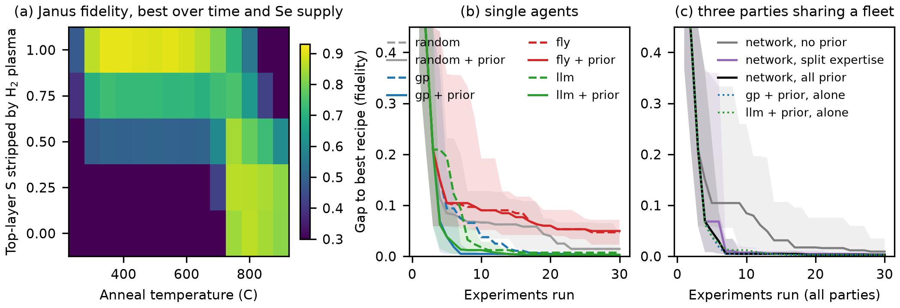

# Campaign example: Janus MoSSe by top-layer selenization of monolayer MoS2

Run 10 Oct 2026. The campaign example is a Janus MoSSe monolayer made from a two-dimensional
transition metal dichalcogenide; it compares an algorithm alone, the connectome model and an LLM
agent as decision makers in an active-learning campaign, as in a self-driving laboratory network
with several learning parties and expertise, with and without prior information.

All results here are simulated (force field plus kinetic Monte Carlo); no furnace was run and no
DFT was done. Code: `src/janus/`. Data: this folder.

## 1. The campaign

A Janus MoSSe monolayer has S on one side and Se on the other. It is made from monolayer MoS2 by
replacing only the top S layer with Se. Two published routes exist:

- thermal selenization in Se vapour near 800 C; at higher temperature the bottom layer also
  exchanges and the flake drifts toward MoSe2 (Zhang et al., ACS Nano 2017, doi 10.1021/acsnano.7b03186);
- H2-plasma stripping of the top S layer at room temperature, then selenization near 350 C
  (Lu et al., Nat. Nanotechnol. 2017, doi 10.1038/nnano.2017.100).

The campaign chooses one furnace recipe per experiment from a grid of 1,400:

| Variable | Values |
|---|---|
| H2-plasma strip (share of top S removed) | 0, 0.25, 0.5, 0.75, 1 |
| anneal temperature | 250 to 900 C in 50 C steps |
| anneal time | 5, 15, 30, 60, 120 min |
| relative Se supply | 0.1, 1, 10, 100 |

Each experiment returns what Raman/XPS on the flake would report: Se share of the top layer, Se
share of the bottom layer, and the defect share, each with 0.02 noise. The score is the Janus
fidelity F = (top Se share) x (1 - bottom Se share) x (1 - defect share). Budget: 30 experiments.

## 2. How an experiment is simulated

**Force field (MACE-MP-0 medium, `src/janus/ff_energetics.py`, `ff_energetics.json`).** On 4x4
monolayer cells:

| Quantity | Mo | W |
|---|---|---|
| lattice constant MS2 / MSe2 / Janus MSSe (A) | 3.182 / 3.316 / 3.248 | 3.189 / 3.321 / 3.251 |
| Janus mixing energy (eV per formula unit) | 0.044 | 0.036 |
| Se replacing a top S in MS2 (eV, end-member reference) | +0.016 | +0.043 |
| Se replacing a bottom S in Janus MSSe (eV) | -0.050 | -0.016 |
| chalcogen-vacancy hop barrier, S / Se layer (NEB, eV) | 0.89 / 0.85 (PBE 2.32 / 2.09) | 1.00 / 0.97 |

The negative bottom-layer value is the force-field reason a Janus flake left too long or too hot
converts toward MSe2. The MACE-MP-0 hop barriers are well below DFT: PBE NEB on the same cells
(`dft_neb/`, 12 Oct 2026) gave 2.32 eV (MoS2, S layer) and 2.09 eV (MoSSe, Se layer), in line with
the DFT value for the S vacancy in MoS2 (about 2.3 eV; Komsa et al., Phys. Rev. B 2013, doi
10.1103/PhysRevB.88.035301). Since 12 Oct 2026 the kMC uses the PBE barriers (`kmc.PBE_HOP`; W:
MACE-MP-0 + the mean Mo offset of 1.33 eV). The hop barrier enters only the damage (vacancy
clustering) step, Ea_hop + dEa_dmg; dEa_dmg was re-tuned from 1.30 eV to 1.30 - 1.33 = -0.03 eV,
so the damage barrier (2.17 eV Mo, 2.29 eV W) is unchanged and the regenerated truth maps are
bit-identical to `truth_Mo.npy` / `truth_W.npy`. No result in this folder changes.

**Kinetic Monte Carlo (`src/janus/kmc.py`).** Two chalcogen layers on a 24 x 24 triangular
lattice; Arrhenius events for Se filling a top vacancy, top and bottom S-to-Se exchange (biased by
the force-field energies and the Se chemical potential set by the supply), chalcogen loss, vacancy
clustering into damage, plasma over-etching and an excess-Se adlayer at low temperature. Barriers
the force field does not give are assumptions, set so that both published windows appear; they are
listed in `kmc.ASSUMED`. Fixed time steps (300 per anneal). The W system (WS2 to WSSe) uses its own
force-field values plus an assumed +0.15 eV on exchange and loss barriers (stronger W-S bonds).

**Recipe map (8 replicates per recipe, `truth_Mo.npy`).** Best mean fidelity 0.91 on the
low-temperature stripped route (strip 1, 350 to 550 C); the thermal route peaks at 0.87 near
750 to 850 C. 30 of 1,400 recipes are within 0.02 of the best.

## 3. Agents and arms

| Arm | Decision maker | Prior information |
|---|---|---|
| random | uniform over untested recipes | none / WSSe data (unused) |
| gp | Gaussian process, upper confidence bound (algorithm only) | none / 30 WS2-to-WSSe results as extra points with a system flag |
| fly | mushroom body on the FlyWire 783 projection-neuron to Kenyon-cell wiring, dopamine-style learning, novelty bonus | none / pre-trained on the WSSe results |
| fly_shuf | same model with partners shuffled (wiring control) | as fly |
| llm | Qwen3.6-35B-A3B on the DGX (local vLLM, no reasoning mode) reading the full readout table | none / WSSe table plus a literature summary of both routes |
| net_none, net_all, net_split | the three parties (gp, fly, llm) share one three-furnace fleet and all results; 10 rounds of 3 | none / all prior to all / split expertise: gp has the WSSe data, llm the literature, fly nothing |

20 seeds per arm; all arms of a seed start from the same 3 random recipes. Results:
`summary.md`, `summary.json`, `fig_janus_campaign.png` (written by `src/janus/analyze.py` and `src/janus/plot.py`).

Caveat on the literature prior: the simulator was set to reproduce the two published windows, so
the literature summary given to the LLM is informative by construction.

## 4. Results (20 seeds per arm, 10 Oct 2026)

Median gap to the best recipe (true mean fidelity 0.907), with the interquartile range; full
table and paired tests in `summary.md`.

| Arm | after 10 runs | after 30 runs | seeds within 0.02 of best |
|---|---|---|---|
| random | 0.066 | 0.014 | 12/20 |
| gp | 0.037 | 0.003 | 17/20 |
| gp + prior | 0.004 | 0.003 | 20/20 |
| fly | 0.090 | 0.047 | 6/20 |
| fly + prior | 0.090 | 0.049 | 5/20 |
| fly, shuffled wiring | 0.082 | 0.018 | 11/20 |
| llm | 0.017 | 0.007 | 15/20 |
| llm + prior | 0.012 | 0.003 | 19/20 |
| network, no prior | 0.084 | 0.009 | 14/20 |
| network, all prior | 0.005 | 0.003 | 20/20 |
| network, split expertise | 0.007 | 0.004 | 19/20 |

1. **Connectome model as optimiser.** It did worse than random selection after 30 runs (0.047 against
   0.014; better in 6 of 20 seeds, not significant after Holm correction) and worse than the same
   circuit with partners shuffled (0.018). Pre-training it on the WSSe results did not help
   (better than no prior in 2 of 20 seeds). The pilot on SiGeC gave the same picture.
2. **Prior information** helped the Gaussian process (p = 0.006 over the area under the gap
   curve) and the LLM (p = 0.43, but 19 against 15 seeds reached the best region).
3. **Sharing results across three parties** made the network faster than the same three parties
   without prior (p = 0.003). In the shared arms the first recipe within 0.02 of the best came
   from the Gaussian process (10 and 13 seeds) or the LLM (8 and 4 seeds), never from the fly
   party; without prior the fly party found it first in 2 of 20 seeds.
4. **Decision time.** The LLM arm took a median 521 s per 30-run campaign against 18-27 s for the
   other arms (simulation time included in all), so about 17 s per LLM decision on the DGX.
